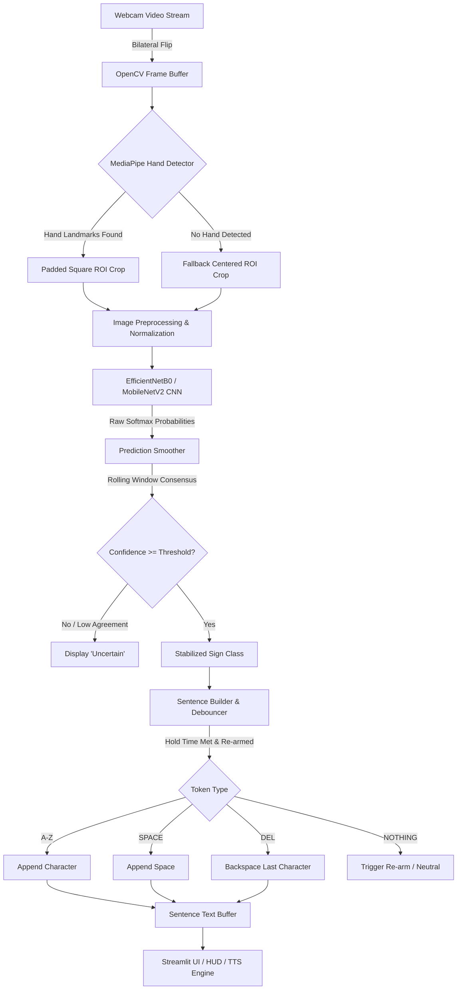

# SignBridge AI — Real-Time American Sign Language (ASL) Recognition

[](https://www.python.org/)
[](https://tensorflow.org/)
[](https://developers.google.com/mediapipe)
[](https://streamlit.io/)
[](LICENSE)

**SignBridge AI** is an end-to-end, real-time computer vision and machine learning system engineered to recognize American Sign Language (ASL) alphabet signs through a standard laptop webcam and synthesize detected signs into readable text and synthesized speech.

Built with **TensorFlow/Keras**, **MediaPipe**, **OpenCV**, and **Streamlit**, SignBridge AI features temporal prediction smoothing, gesture debouncing, re-arming mechanisms, text editing controls, and an educational suite designed for portfolio demonstrations and academic research.

---

## 📑 Table of Contents
1. [Key Features](#-key-features)
2. [Linguistic Scope & Disclaimer](#-linguistic-scope--disclaimer)
3. [System Architecture & Data Flow](#-system-architecture--data-flow)
4. [Dataset Setup (Kaggle ASL Alphabet)](#-dataset-setup-kaggle-asl-alphabet)
5. [Installation & Environment Setup](#-installation--environment-setup)
6. [Model Training](#-model-training)
7. [Model Evaluation & Diagnostics](#-model-evaluation--diagnostics)
8. [Real-Time Applications](#-real-time-applications)
   - [A. Modern Streamlit Web Studio (`app.py`)](#a-modern-streamlit-web-studio-apppy)
   - [B. High-Performance OpenCV Desktop HUD (`src/webcam.py`)](#b-high-performance-opencv-desktop-hud-srcwebcampy)
9. [Webcam Calibration & Custom Data Collection](#-webcam-calibration--custom-data-collection)
10. [Automated Test Suite](#-automated-test-suite)
11. [Understanding the Reality Gap (Domain Shift)](#-understanding-the-reality-gap-domain-shift)
12. [Troubleshooting Guide (macOS / VS Code)](#-troubleshooting-guide-macos--vs-code)
13. [GitHub Setup & Push Guide](#-github-setup--push-guide)

---

## ✨ Key Features

- **29 Hand Gesture Classes:** Full support for 26 ASL alphabet letters (`A`–`Z`) and special control tokens (`SPACE`, `DEL`, and neutral `NOTHING`).
- **High-Framerate Tracking:** MediaPipe Hands extracts 21 3D hand landmarks in real time with aspect-ratio preserving bounding box segmentation.
- **Anti-Flicker Temporal Smoother:** Rolling-window majority voting with confidence gating reduces jitter and discards ambiguous frames (`Uncertain`).
- **Debounced Sentence Construction:** Prevents repeat character spamming while a sign is held. Requires clear hold duration and enforces re-arming via neutral release or cooldown intervals.
- **Text-to-Speech (TTS):** Asynchronous speech synthesis using macOS native `/usr/bin/say` and cross-platform `pyttsx3`.
- **Double Application Frontend:**
  1. **Streamlit Web Application (`app.py`):** Interactive dashboard with dark-mode glassmorphic styling, live camera feed, static image testing, and reference guides.
  2. **Zero-Latency Desktop HUD (`src/webcam.py`):** Direct OpenCV window rendering 30+ FPS with augmented reality status overlays.
- **100% Local Offline Inference:** No cloud APIs or external data transfers required; runs directly on CPU or Apple Silicon Metal.

---

## ⚠️ Linguistic Scope & Disclaimer

> **Important Distinction: Finger-Spelling vs. Continuous ASL**  
> SignBridge AI implements **finger-spelling orthographic transcription** (letter-by-letter spelling).
> 
> In American Sign Language, finger-spelling is utilized primarily for proper nouns, names, and specialized terminology. SignBridge AI is **NOT** a translator for continuous ASL grammar, which requires non-manual signals (facial expressions, mouth morphemes, eyebrow positioning), spatial indexing, torso shifts, and fluid multi-sign transitions. Independent alphabet classification does not comprehend grammatical syntax or word meaning.

---

## 🏛️ System Architecture & Data Flow



---

## 📦 Dataset Setup (Kaggle ASL Alphabet)

SignBridge AI utilizes the benchmark [Kaggle ASL Alphabet Dataset](https://www.kaggle.com/datasets/grassknoted/asl-alphabet) (87,000 images, 3,000 images per class across 29 classes).

### Option 1: Automatic Download via Kaggle CLI (Recommended)

1. **Install Kaggle CLI:**
   ```bash
   pip install kaggle
   ```

2. **Configure API Credentials Securely:**
   - Go to [kaggle.com/settings](https://www.kaggle.com/settings) -> Scroll to **API** -> Click **Create New Token**.
   - A file named `kaggle.json` will be downloaded.
   - Secure it into your home directory (never commit `kaggle.json` to Git):
     ```bash
     mkdir -p ~/.kaggle
     mv ~/Downloads/kaggle.json ~/.kaggle/
     chmod 600 ~/.kaggle/kaggle.json
     ```

3. **Download and Extract Dataset:**
   ```bash
   mkdir -p dataset
   kaggle datasets download -d grassknoted/asl-alphabet -p dataset/ --unzip
   ```

### Option 2: Manual Download
1. Download the archive from [Kaggle ASL Alphabet](https://www.kaggle.com/datasets/grassknoted/asl-alphabet).
2. Extract the archive directly into `dataset/`.

### Dataset Directory Structure Notice
Kaggle packages this dataset with a nested directory structure:
```
dataset/
├── asl_alphabet_train/
│   └── asl_alphabet_train/
│       ├── A/       (3,000 images)
│       ├── B/       (3,000 images)
│       ├── ...
│       ├── del/     (3,000 images)
│       ├── nothing/ (3,000 images)
│       └── space/   (3,000 images)
└── asl_alphabet_test/
    └── asl_alphabet_test/
        ├── A_test.jpg
        └── ... (28 sample images)
```

> **Dataset Integrity Note:** The original Kaggle `asl_alphabet_test` directory contains only **28 single sample images** (one per class, with `del` omitted). This is insufficient for statistical evaluation. SignBridge AI automatically performs stratified splits from the 87,000 images to evaluate true generalization.

Inspect and verify your dataset anytime by running:
```bash
python scripts/inspect_dataset.py
```

---

## 💻 Installation & Environment Setup

### 1. Prerequisites
- macOS (Apple Silicon M1/M2/M3/M4 or Intel) or Linux / Windows.
- Python 3.10 or 3.11 installed.

### 2. Create Virtual Environment
Open Terminal in the project root:
```bash
cd /Users/manikgupta/Desktop/SignBridge-AI
python3.11 -m venv .venv
source .venv/bin/activate
```

### 3. Install Dependencies
```bash
pip install --upgrade pip
pip install -r requirements.txt
```

### 4. macOS Camera Permission Configuration
On macOS, camera access is sandboxed:
1. Open **System Settings** -> **Privacy & Security** -> **Camera**.
2. Ensure **Terminal**, **iTerm**, or **Visual Studio Code** has camera access enabled.

---

## 🧠 Model Training

Train a new model with transfer learning on EfficientNetB0 or MobileNetV2:

```bash
# Basic transfer learning training
python train.py --model_type efficientnet_b0 --epochs 8 --batch_size 32

# With fine-tuning of backbone layers
python train.py --model_type efficientnet_b0 --epochs 8 --fine_tune --fine_tune_epochs 4

# Lightweight MobileNetV2 alternative
python train.py --model_type mobilenet_v2 --epochs 10 --batch_size 32
```

Outputs generated in `models/trained/`:
- `signbridge_efficientnet.keras` (Trained model weights)
- `class_indices.json` (Exact label-to-index mapping)
- `preprocessing_config.json` (Input dimensions and normalization metadata)
- `results/training_curves_efficientnet_b0.png` (Training & validation loss/accuracy curves)

---

## 📊 Model Evaluation & Diagnostics

Evaluate the model against held-out test data to obtain confusion matrices, classification reports, and latency metrics:

```bash
python evaluate.py --samples 580
```

Outputs generated in `results/`:
- `confusion_matrix.png`: Heatmap showing true vs. predicted signs.
- `evaluation_metrics.json`: Accuracy, Macro F1, precision, recall, and FPS metrics.
- `evaluation_report.md`: Detailed diagnostic breakdown.

### Single Image Prediction CLI
Test any static image with visual confidence bars:
```bash
python predict.py dataset/asl_alphabet_test/asl_alphabet_test/A_test.jpg --visualize
```

---

## 🚀 Real-Time Applications

### A. Modern Streamlit Web Studio (`app.py`)
Launch the rich interactive web application:
```bash
streamlit run app.py
```
- **Features:** Live webcam preview, Top Prediction display, Real-time confidence bar, Sentence accumulation panel, Text-to-Speech (`Speak` button), Copy to clipboard, Undo & Clear, and ASL Alphabet Guide.

### B. High-Performance OpenCV Desktop HUD (`src/webcam.py`)
Launch the zero-latency native desktop window:
```bash
python -m src.webcam
```
**Interactive Keyboard Controls:**
- `[SPACE]` : Insert manual space
- `[C]` : Clear accumulated sentence
- `[U]` : Undo last character
- `[S]` : Speak sentence via Text-to-Speech
- `[L]` : Toggle MediaPipe skeletal landmarks
- `[Q]` or `[ESC]` : Safely exit and release webcam

---

## 📸 Webcam Calibration & Custom Data Collection

To bridge the **Reality Gap** (differences between studio training images and your laptop webcam), record custom calibration gestures:

```bash
# Capture custom samples for class 'A'
python scripts/collect_webcam_data.py A

# Capture custom samples for class 'B'
python scripts/collect_webcam_data.py B
```
- Press `[SPACE]` to capture a single image.
- Press `[C]` to trigger a 20-frame burst capture.
- Images are automatically cropped and saved to `dataset/custom/<class>/`.

---

## 🧪 Automated Test Suite

SignBridge AI includes automated unit tests covering image normalization, ROI cropping, prediction smoothing, and sentence debouncing:

```bash
pytest tests/ -v
```

---

## 🌐 Understanding the Reality Gap (Domain Shift)

> **Why 99% accuracy on Kaggle does not automatically guarantee 99% accuracy on a live webcam:**

1. **Background Clutter:** The Kaggle dataset features uniform studio backgrounds. Real-world rooms contain lamps, shadows, and colored furniture.
2. **Webcam Angle & Perspective:** Laptop cameras look upward at an angle, causing finger foreshortening.
3. **Lighting & Shadows:** Tungsten lamps and ceiling lights cast sharp shadows between fingers, altering edge gradients.
4. **Dynamic Motion Blur:** Fast hand movements cause motion blur absent from static dataset photos.

**How SignBridge AI mitigates the reality gap:**
- **MediaPipe Segmentation:** Dynamically isolates the hand bounding box from the background.
- **Aspect-Ratio Preserved Cropping:** Maintains square aspect ratios to prevent warping.
- **Temporal Window Smoothing:** Eliminates transient single-frame false predictions.
- **Webcam Calibration Tool:** Lets users fine-tune on their specific room environment.

---

## 🔧 Troubleshooting Guide (macOS / VS Code)

| Symptom | Cause | Solution |
| :--- | :--- | :--- |
| `Could not open camera at index 0` | macOS camera permission denied | Go to **System Settings -> Privacy & Security -> Camera** and enable Terminal / VS Code. |
| `Camera frames black / freeze` | Another app is locking the camera | Close Zoom, FaceTime, or Photo Booth. |
| External USB webcam not detected | Default index is built-in camera | Run with `--camera 1` or `--camera 2`. |
| TensorFlow Metal MPS error on Apple Silicon | MPS shader cache glitch | Set environment variable: `export TF_ENABLE_ONEDNN_OPTS=0` or run on CPU: `export CUDA_VISIBLE_DEVICES=""`. |
| `Audio / TTS does not play sound` | Audio muted or pyttsx3 blocked | macOS uses native `/usr/bin/say`. Verify volume is unmuted in System Settings. |

---

## 📤 GitHub Setup & Push Guide

To push this repository to GitHub:

```bash
# 1. Initialize git if not already initialized
git init

# 2. Stage files (large datasets and binaries are excluded by .gitignore)
git add .

# 3. Create initial commit
git commit -m "feat: complete SignBridge AI real-time ASL recognition suite"

# 4. Link your GitHub remote repository
git remote add origin https://github.com/<your-username>/SignBridge-AI.git

# 5. Push to GitHub
git branch -M main
git push -u origin main
```

---

## 📄 License
This project is licensed under the **MIT License**. See `LICENSE` for details.
